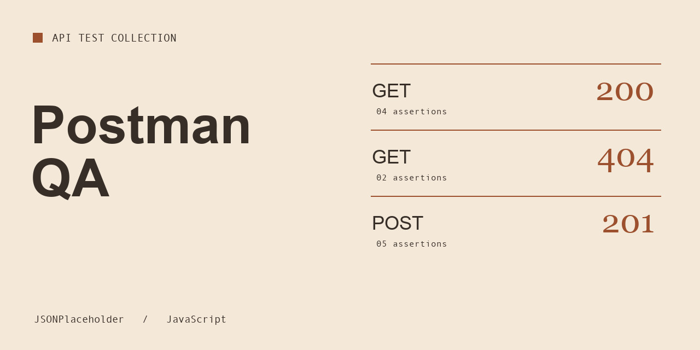

<a href="README.md"><picture><source media="(max-width: 600px)" srcset="https://raw.githubusercontent.com/mrjakeball/mrjakeball/main/assets/navigation/ru-on-compact.svg?v=3"></picture></a>
<a href="README_EN.md"><picture><source media="(max-width: 600px)" srcset="https://raw.githubusercontent.com/mrjakeball/mrjakeball/main/assets/navigation/en-off-compact.svg?v=3"></picture></a>
<a href="https://github.com/mrjakeball/portfolio"><picture><source media="(max-width: 600px)" srcset="https://raw.githubusercontent.com/mrjakeball/mrjakeball/main/assets/navigation/catalog-ru-compact.svg?v=3"></picture></a>

# Практика QA с Postman

Три запроса к JSONPlaceholder показывают, как проверить существующего пользователя, отсутствующую запись и создание публикации. В экспортированной коллекции 11 проверок на JavaScript.

| Запрос | Что проверяется | Проверок |
| --- | --- | ---: |
| GET · пользователь | HTTP 200, ID, имя и непустой email | 4 |
| GET · отсутствующая запись | HTTP 404 и пустой объект JSON | 2 |
| POST · публикация | HTTP 201, присвоенный ID и три отправленных поля | 5 |

## Запуск коллекции

Скачайте [JSON-файл](01-api-testing/JSONPlaceholder.postman_collection.json), импортируйте его в Postman и запустите три запроса в Collection Runner. На вкладке **Test Results** можно сверить каждую проверку с телом ответа.

Продолжение темы — [отдельная работа с PUT, PATCH и DELETE](https://github.com/mrjakeball/appsec-labs/blob/main/api-testing/01-rest-api-fundamentals/README.md).

[Профиль](https://github.com/mrjakeball) · [Каталог проектов](https://github.com/mrjakeball/portfolio)
