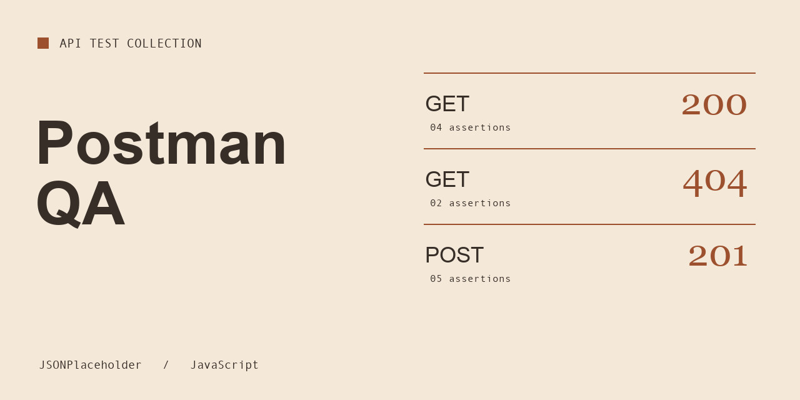

# API testing with Postman

Three requests to JSONPlaceholder cover an existing user, a missing record and creation of a post. The exported collection contains 11 JavaScript assertions.

| Request | Expected response | Assertions |
| --- | --- | ---: |
| GET · existing user | HTTP 200, ID, name and a non-empty email | 4 |
| GET · missing user | HTTP 404 and an empty JSON object | 2 |
| POST · create post | HTTP 201, assigned ID and the three submitted fields | 5 |

## Run the collection

Download the [collection JSON](01-api-testing/JSONPlaceholder.postman_collection.json), import it into Postman and run all three requests in Collection Runner. Under **Test Results**, compare individual assertions with the response body.

The [companion exercise with PUT, PATCH and DELETE](https://github.com/mrjakeball/appsec-labs/blob/main/api-testing/01-rest-api-fundamentals/README_EN.md) includes a recorded run.

[Profile](https://github.com/mrjakeball/mrjakeball/blob/main/README_EN.md) · [Project catalogue](https://github.com/mrjakeball/portfolio/blob/main/README_EN.md)
